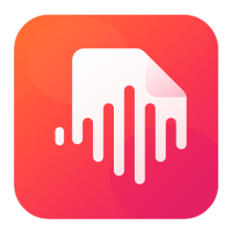
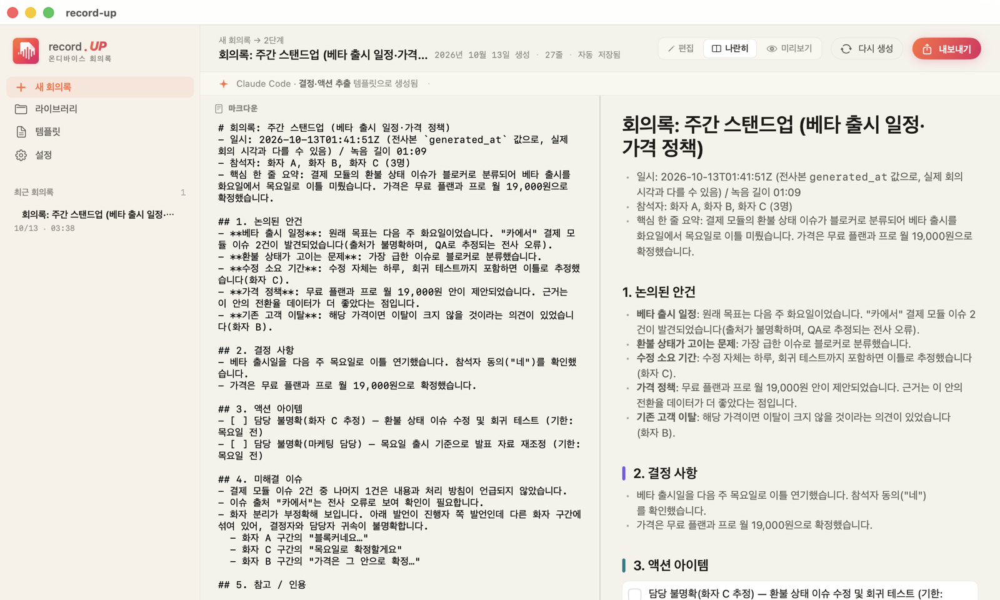
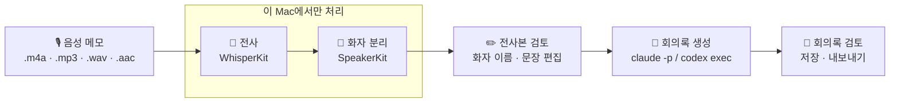
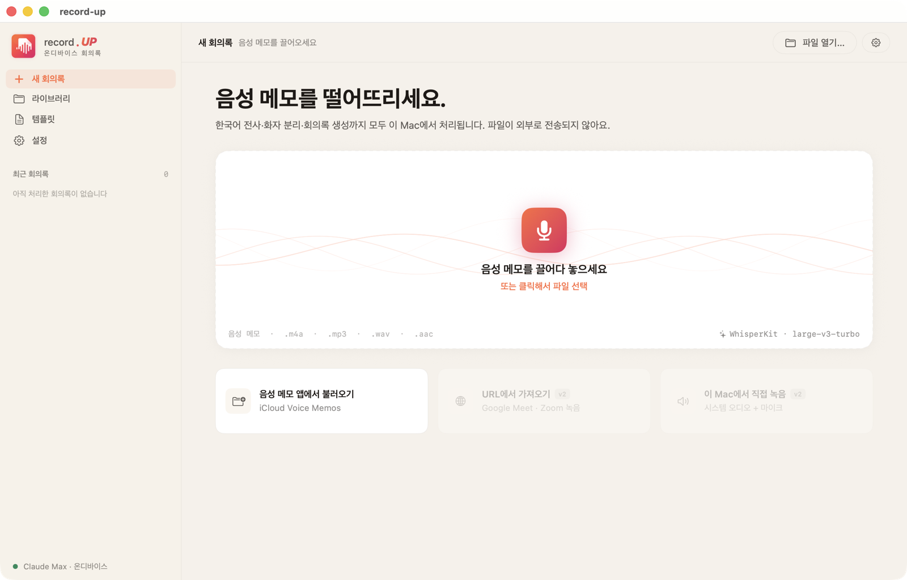
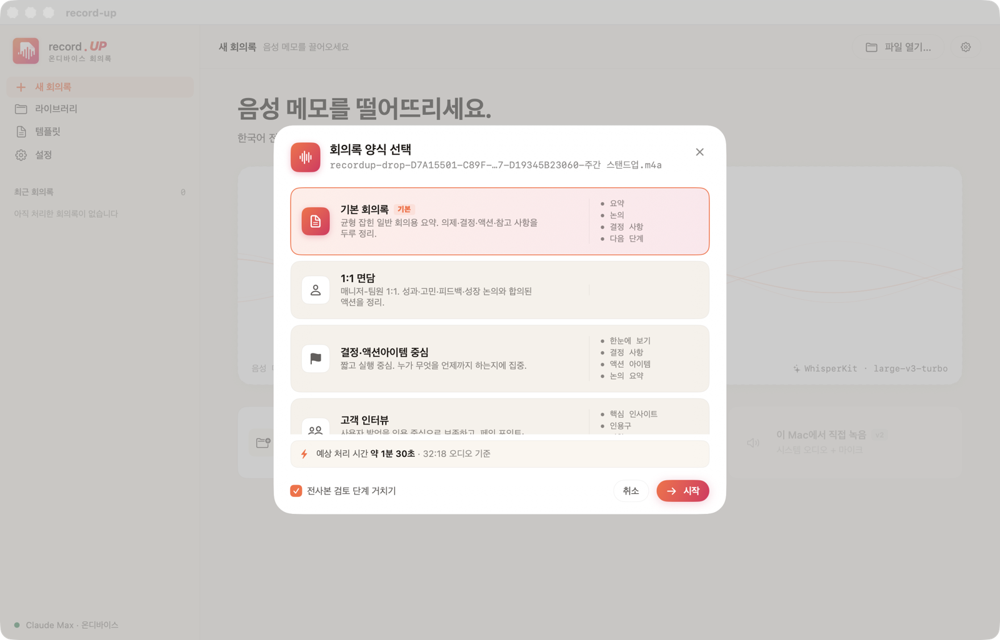
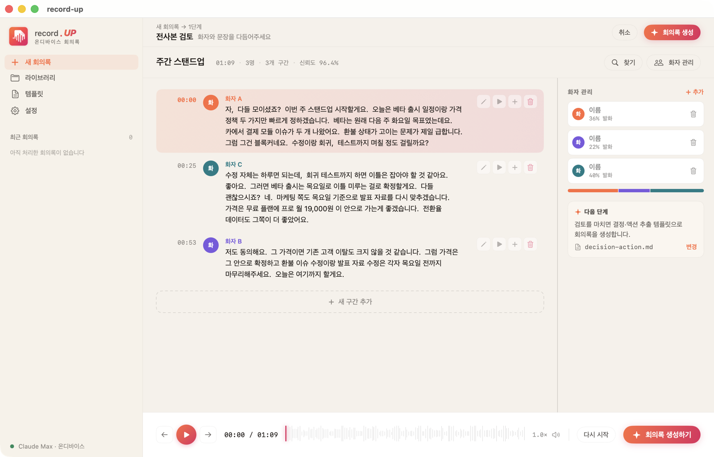
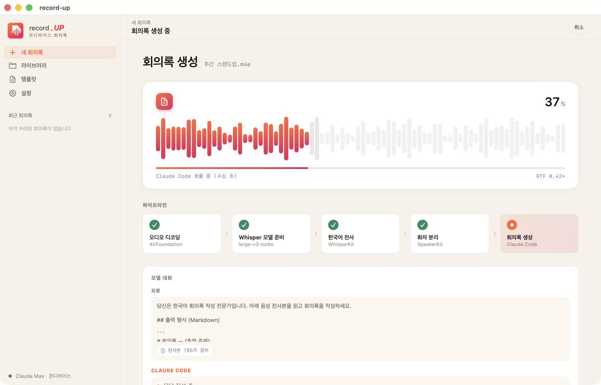
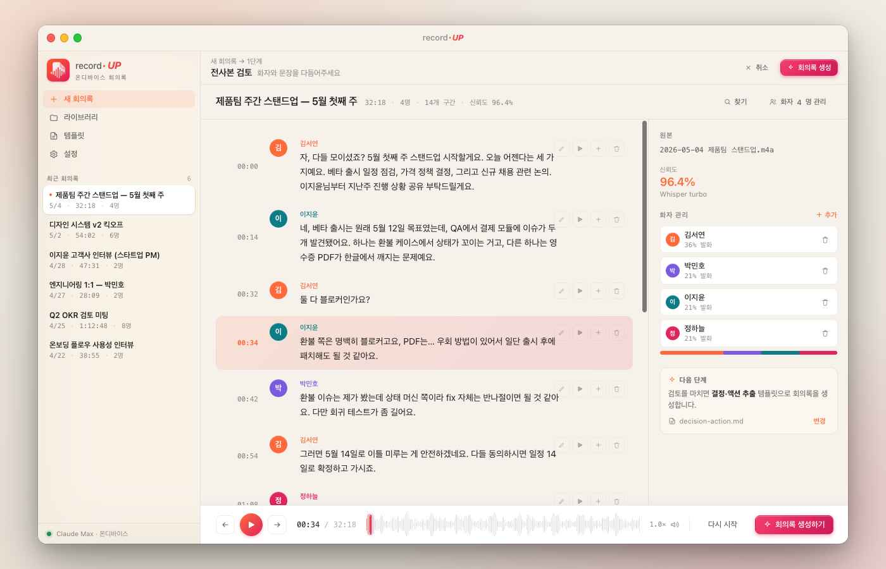
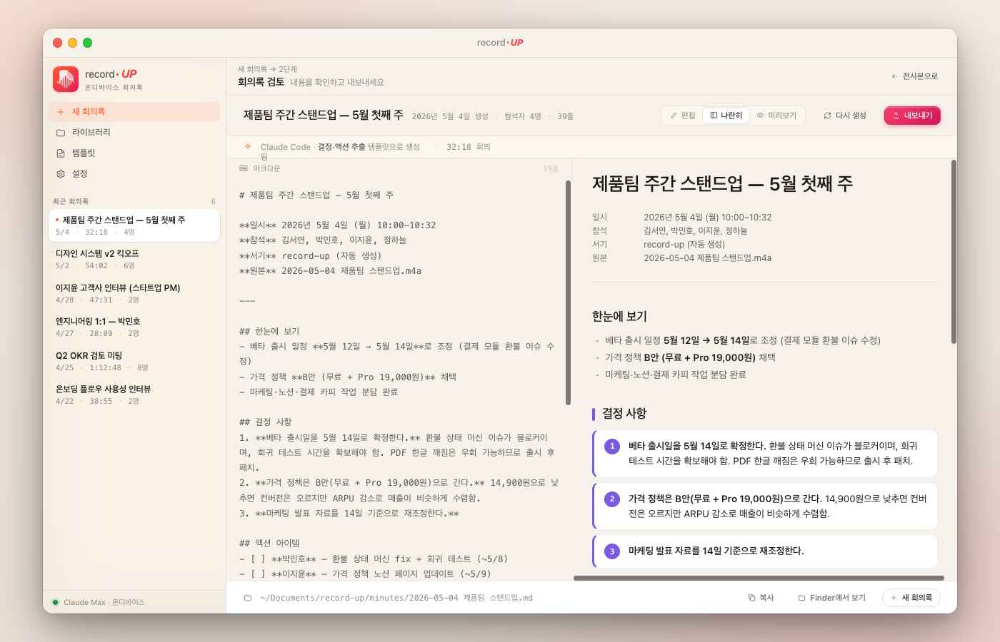

<p align="center">
  
</p>

<h1 align="center">record-up</h1>

<p align="center">
  음성 메모를 떨어뜨리면 <b>한국어 전사 → 화자 분리 → 회의록</b>까지 한 번에.<br>
  전사·화자 분리는 100% 이 Mac 안에서 처리합니다.
</p>

<p align="center">
  
  
  
  
  
</p>

<p align="center">
  <a href="#1-설치">설치</a> ·
  <a href="#2-사용">사용법</a> ·
  <a href="#특징">특징</a> ·
  <a href="#3-빌드-사전-셋업-개발자-1회">개발자 빌드</a>
</p>

<p align="center">
  
</p>

## 1. 설치

### 준비물

- Apple Silicon Mac (M1+), macOS 14 (Sonoma) 이상
- RAM 8GB+, 디스크 여유 2GB+ (앱 + 동봉 모델 약 650MB)
- 회의록 생성용 AI CLI 하나 이상 — **미리 설치하고 로그인**까지 해 두세요

  ```sh
  # Claude Code (Claude Max 구독)
  npm install -g @anthropic-ai/claude-code
  claude          # 첫 실행에서 로그인

  # 또는 Codex CLI
  npm install -g @openai/codex
  codex login
  ```

### 설치 순서

1. [Releases](https://github.com/toyunity/recordUp/releases/latest)에서 `record-up-<버전>.pkg` 를 받습니다.
2. pkg를 **우클릭 → 열기**로 실행합니다. 셀프 사인이라 첫 실행만 Gatekeeper 우회가 필요합니다.
   - 열기 버튼이 안 보이면 **시스템 설정 → 개인정보 보호 및 보안**에서 **그래도 열기**를 누릅니다.
3. **설치 유형** 단계에서 회의록 생성 AI 도구를 고릅니다 (Claude / Codex 중 하나).
4. 설치가 끝나면 `/Applications/recordup.app` 을 실행합니다.

고른 도구는 앱의 기본 생성 엔진으로 저장됩니다.
나중에 **설정 → AI 도구 연결**에서 바꿀 수 있습니다.

```sh
# 설치 마법사에서 고른 값 확인
defaults read com.toyunity.recordup defaultEngineID
```

## 2. 사용



1. 음성 메모(`.m4a` · `.mp3` · `.wav` · `.aac`)를 드래그&드롭하거나, **음성 메모 앱에서 불러오기**로 Voice Memos 녹음 폴더에서 선택

   

2. 회의록 템플릿 선택
   - 기본 회의록 / 결정·액션아이템 중심 / 고객 인터뷰 / 1:1 면담 / 기획 요구사항 회의 / 기획·브레인스토밍 / 스프린트 회고 / 주간 업무보고·공유

   

3. 전사·화자 분리 후 **화자 이름 매핑·세그먼트 편집**

   

4. AI 도구가 회의록 생성 — 진행 화면에서 프롬프트와 응답이 실시간으로 표시됨

   

5. 회의록 검토 → 재생성 / 저장 / 내보내기 (Markdown · PDF · RTF · 공유)

결과는 자동 저장되며 **라이브러리** 탭에서 다시 열 수 있습니다.

> 스크린샷은 실제 앱에 샘플 녹음(TTS로 만든 69초 가상 회의)을 넣어 캡처한 화면입니다.
>
> 첫 전사 때는 macOS가 Whisper 모델을 Neural Engine용으로 최적화하느라 **2~3분** 동안 95%에서 멈춘 듯 보일 수 있습니다. 한 번만 일어나며, 이후에는 바로 시작합니다.

<details>
<summary>디자인 시안 보기</summary>

<br>

초기 디자인 시안(`design/screenshots/`)입니다. 실제 앱과 일부 다를 수 있습니다.




</details>

## 특징

- 100% 온디바이스 STT + 화자 분리 (Apple Silicon, CoreML)
- STT 모델이 **앱에 동봉**돼 설치 직후 오프라인으로 바로 전사 (모델 다운로드 없음)
- 회의록 생성은 본인의 AI CLI 구독을 그대로 사용 — `claude -p`(Claude Max) 또는 `codex exec`
- 설치 마법사(`.pkg`)의 **설치 유형** 단계에서 회의록 생성 AI 도구 선택
- Xcode IDE 없이 CLI로 빌드 (`xcodegen` + `xcodebuild`)
- Python·HF 토큰 등 런타임 외부 의존 **없음**

> **개인정보** — 오디오는 외부로 전송되지 않습니다. 회의록 생성 시에는 전사본 텍스트가 선택한 AI 서비스(Anthropic 또는 OpenAI)로 전송되어 해당 서비스 약관에 따라 처리됩니다. 녹음과 AI 전송은 참석자 동의를 받은 뒤 사용하세요.

## 3. 빌드 사전 셋업 (개발자, 1회)

### 3-1. Xcode 정식 앱 설치
SwiftUI 빌드를 위해 macOS SDK가 필요합니다. **Xcode IDE는 안 쓰지만 앱은 설치돼 있어야** 합니다.

```sh
# App Store에서 "Xcode" 설치 후, Command Line Tools가 아닌 Xcode를 가리키게 한다:
sudo xcode-select -s /Applications/Xcode.app
sudo xcodebuild -license accept
xcode-select -p   # → /Applications/Xcode.app/Contents/Developer 가 나오면 OK
```

### 3-2. Homebrew 도구 설치
```sh
brew install xcodegen hf      # hf: 모델 다운로드용 Hugging Face CLI
brew install create-dmg       # (선택) DMG 패키징을 쓸 때만
```

`.pkg` 패키징에 쓰는 `pkgbuild` / `productbuild` 는 macOS 기본 도구라 따로 설치할 필요가 없습니다.

## 4. 릴리즈 (원샷)

```sh
./Scripts/release.sh
```

이 한 줄로 다음을 모두 처리합니다.

1. `Resources/models/` 가 비어 있으면 `fetch-models.sh` 자동 실행 (Whisper large-v3-turbo + SpeakerKit CoreML 모델, 약 650MB)
2. `build.sh` (XcodeGen → xcodebuild Release → ad-hoc 셀프 사인)
3. `package-pkg.sh` (설치 마법사 `.pkg` 생성 + SHA256 체크섬)

산출물:

```
dist/
├── record-up-<버전>.pkg
└── record-up-<버전>.pkg.sha256
```

> 네트워크 제한으로 모델 다운로드가 막히면 다른 네트워크에서 `./Scripts/fetch-models.sh` 를 한 번만 실행하세요. 받은 모델은 `.app` 번들에 동봉되므로 이후로는 오프라인 동작합니다.

### 단계별로 실행하고 싶다면

```sh
./Scripts/fetch-models.sh  # 동봉할 모델만 다운로드
./Scripts/build.sh         # 앱 빌드만
./Scripts/package-pkg.sh   # 설치 마법사(.pkg) — 빌드 산출물이 없으면 build.sh 자동 호출
./Scripts/package-dmg.sh   # (선택) 드래그 설치형 DMG — AI 도구 선택 단계 없음
```

### 무결성 확인

```sh
cd dist && shasum -a 256 -c record-up-<버전>.pkg.sha256
```

## 5. 개발 (Xcode IDE 없이)

코드는 **VSCode / Cursor** 등 임의의 에디터에서 작성합니다. Swift 자동완성은 `swiftlang.swift-vscode` 확장 권장.

```sh
# 코드 변경 후
./Scripts/build.sh && open .build/Build/Products/Release/recordup.app
```

`recordup.xcodeproj` 는 매 빌드마다 `xcodegen` 이 다시 만들기 때문에 직접 편집하지 마세요. 프로젝트 구성 변경은 `project.yml` 만 편집합니다.

모듈별 상세 문서는 [`docs/modules/`](docs/modules), 디자인 시스템은 [`docs/patterns/theme.md`](docs/patterns/theme.md)를 참고하세요.

### AI 도구 추가·수정

회의록 생성 엔진은 코드가 아니라 [`Resources/ai-tools.json`](Resources/ai-tools.json)에 선언합니다(탐지 경로·버전 인자·호출 방식·인증 파일). 도구를 추가하면 설정 화면에 자동으로 나타나며, 설치 마법사 선택지는 `Scripts/package-pkg.sh` 의 `ENGINES` 배열에 함께 추가합니다.

## 6. 디렉토리 구조

```
record-up/
├── project.yml              # XcodeGen 정의 (버전: MARKETING_VERSION / CURRENT_PROJECT_VERSION)
├── Sources/recordup/
│   ├── App.swift · AppPaths.swift · Theme*.swift
│   ├── Root/                # 사이드바, 라우팅, 드롭·진행 화면
│   ├── Audio/               # 16kHz mono PCM 로드, 재생
│   ├── STT/                 # WhisperKit 래퍼
│   ├── Pipeline/            # TranscribeJob 2-Phase + 화자 분리 + 편집 모델
│   ├── AITools/             # AI CLI 탐지·로그인 확인·회의록 생성 실행
│   ├── Claude/              # 프롬프트 템플릿 로드·CRUD
│   ├── Export/              # 전사본/회의록 Markdown, PDF/RTF
│   ├── Library/             # 회의록 인덱스·핀·릴리스 노트
│   └── Sheets/              # 검토·라이브러리·설정·템플릿 화면
├── Resources/
│   ├── ai-tools.json        # 회의록 생성 AI 도구 정의 (claude / codex)
│   ├── prompts/             # 회의록 프롬프트 템플릿 8종
│   ├── release-notes.json   # 앱 설정 화면에 표시되는 릴리스 노트
│   └── models/              # 동봉 CoreML 모델 (git 미포함, fetch-models.sh로 받음)
├── Scripts/
│   ├── build.sh             # XcodeGen + xcodebuild + ad-hoc 사인
│   ├── fetch-models.sh      # Whisper / SpeakerKit CoreML 모델 다운로드
│   ├── package-pkg.sh       # 설치 마법사 .pkg (AI 도구 선택) + SHA256
│   ├── package-dmg.sh       # (선택) DMG + INSTALL.txt + SHA256
│   └── release.sh           # 원샷 (모델 fetch → build → pkg)
├── docs/                    # 모듈 문서 · 디자인 패턴 · 설계/분석 리포트
└── dist/                    # 패키지 산출물 (git 미포함)
```

## 7. 데이터 저장 위치

| 용도 | 경로 |
|---|---|
| STT 모델 | `recordup.app/Contents/Resources/models/` (앱 번들 동봉) |
| 전사본 | `~/Documents/record-up/transcripts/` |
| 회의록 | `~/Documents/record-up/minutes/` |
| 사용자 정의 템플릿 | `~/Documents/record-up/Templates/` |
| 기본 생성 엔진 | UserDefaults `defaultEngineID` (기본값 `claude`) |
| AI 도구별 실행 파일 경로 캐시 | UserDefaults `aiToolPath.<id>` |

## 8. 비범위 (의도적으로 제외)

- 앱 내 직접 녹음
- Mac App Store 배포 / 노타리제이션
- Intel Mac
- Windows — 이식 검토는 [Windows 이식 분석 리포트](docs/superpowers/specs/2026-10-12-windows-port-analysis.html) 참고
- 다국어 UI

## 9. 의존 라이브러리 · 모델

- [argmaxinc/WhisperKit](https://github.com/argmaxinc/WhisperKit) v1.0.0 (`WhisperKit` + `SpeakerKit` 두 product)
- STT: OpenAI whisper-large-v3-turbo (Argmax CoreML 4-bit 압축본, MIT)
- 토크나이저: [openai/whisper-large-v3](https://huggingface.co/openai/whisper-large-v3) (Apache-2.0)
- 화자 분리: [argmaxinc/speakerkit-coreml](https://huggingface.co/argmaxinc/speakerkit-coreml) (CC BY 4.0, pyannote 계열)

라이선스 고지 전문은 [THIRD_PARTY_NOTICES.md](THIRD_PARTY_NOTICES.md)에 있으며, 앱의 **설정 → 오픈소스**에서도 볼 수 있습니다.
